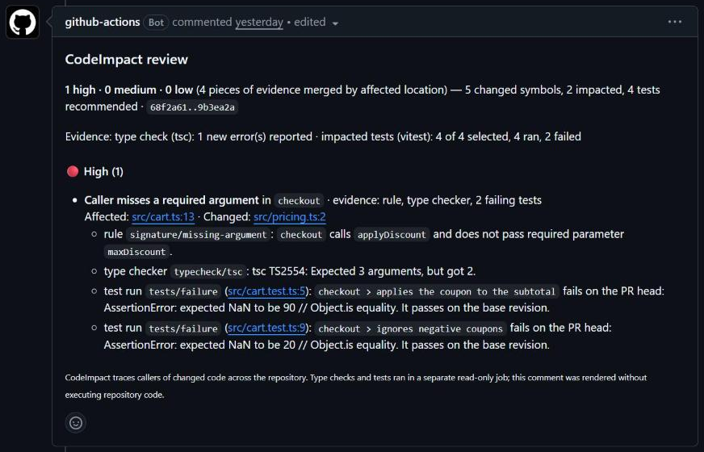

# CodeImpact

**CodeImpact is an impact-aware pull request reviewer. It catches the breakages a pull request causes outside its own diff.** Most reviewers read the changed lines. CodeImpact parses the base and head revisions of a Python or TypeScript repository and finds every symbol the pull request changed. It then follows their callers through a static dependency graph and checks those callers against the new contract: signatures, removed or renamed symbols, broken imports, return values and raised exceptions. It can also run the project's type checker and the impacted tests, keeping only errors and failures that are new on the PR head. Evidence pointing at the same caller is merged into one finding, posted as a single pull request comment that is edited in place on every push. It is deterministic and runs without a language model or any paid service.



*The comment on [codeimpact-demo#1](https://github.com/Haider425/codeimpact-demo/pull/1). The pull request adds a required parameter to `applyDiscount()` in `src/pricing.ts` and does not update its caller in `src/cart.ts`, which is not in the diff. A rule, `tsc`, and two `checkout` tests that pass on `main` all point at the same line.*

## Add it to a repository

Create `.github/workflows/codeimpact.yml`:

```yaml
name: CodeImpact
on:
  pull_request:
    types: [opened, synchronize, reopened, ready_for_review]
permissions: {}
concurrency:
  group: codeimpact-${{ github.event.pull_request.number }}
  cancel-in-progress: true

jobs:
  analyze:                      # runs repository code; read-only token
    runs-on: ubuntu-latest
    timeout-minutes: 20
    permissions:
      contents: read
    steps:
      - uses: actions/checkout@v4
        with:
          ref: ${{ github.event.pull_request.head.sha }}
          fetch-depth: 0              # the merge base must be available
          persist-credentials: false
      - uses: actions/setup-node@v4
        with:
          node-version: 24
      - uses: Haider425/codeImpact/actions/analyze@v0.1.0
        with:
          install-command: npm ci     # or: pip install -e ".[test]"
          typecheck: true             # optional, off by default
          run-tests: true             # optional, off by default

  comment:                      # never runs repository code; may write the PR comment
    needs: analyze
    if: ${{ !cancelled() }}
    runs-on: ubuntu-latest
    timeout-minutes: 5
    permissions:
      pull-requests: write
    steps:
      - uses: Haider425/codeImpact/actions/comment@v0.1.0
        with:
          fail-on-high: false         # true fails the check when high-severity findings exist
```

The analyzer needs Node 22.12 or newer on the runner, which `setup-node` provides. Python projects also need Python; pyright is installed automatically when `typecheck` is on.

**`actions/analyze` inputs**

| Input | Default | |
|---|---|---|
| `install-command` | none | Installs the project's dependencies. Needed for type checks and test runs. |
| `typecheck` | `false` | Run `tsc` (needs a `tsconfig.json`) or pyright (needs a pyright or mypy config) on base and head, and report only new errors in code the PR did not change. |
| `run-tests` | `false` | Run the top-ranked impacted tests with pytest, vitest or jest. Failures are re-run on the base revision, and only tests that pass there are reported. |
| `max-tests` | `20` | Upper bound on impacted tests to run. |
| `timeout-seconds` | `300` | Time limit for each type-check or test run. |
| `base`, `head` | PR base and head SHAs | Commit range to analyze; the diff starts at their merge base. |

**`actions/comment` inputs:**

- `fail-on-high` (default `false`).
- `show-low-severity` (default `false`). Low-severity findings are counted but not listed, because on real pull requests they were almost all noise (see below).
- `github-token` (default: the workflow token).
- `dry-run`: render to the log and the job summary only.

**Security model.**

- **Static analysis** never executes repository code; it parses source as untrusted text.
- **Analyze job.** The opt-in type-check and test-run evidence does execute repository code: your dependency install and your tests. So this job gets `contents: read` and no write token, and checks out with `persist-credentials: false`. Type checkers and tests run in a temporary copy of each revision, with an environment stripped of tokens and secrets and a hard time limit.
- **Comment job.** It holds `pull-requests: write`, never checks out or executes the pull request's code, and runs one dependency-free script.
- **Report artifact.** It comes from a job that ran repository code, so the comment step treats it as untrusted. It validates every field, escapes HTML and markdown, and neutralizes `@mentions`, URLs and `#123` references. It also truncates long output, and builds links only from validated paths and the commit SHAs in the trusted event payload.
- **Trigger.** Do not use `pull_request_target`. Fork pull requests get a read-only token, so for them the results go to the job summary instead of a comment.

This repository reviews its own pull requests with the same actions, pinned to `v0.1.0`, in [.github/workflows/codeimpact.yml](.github/workflows/codeimpact.yml).

## Benchmark

The full method, per-bug-type tables, the real-PR spot-check and every limitation are in [benchmark/REPORT.md](benchmark/REPORT.md). Reproduce it with `npm run bench`.

The benchmark injects one breaking change at a time into three real repositories: pallets/itsdangerous, pallets/click and unjs/ufo. The break types are a new required parameter, a rename, a deletion, a changed return shape, and a newly raised exception. A text-based oracle, independent of CodeImpact's parser, marks every call site the change breaks. The only tuned setting, the severity threshold, was chosen on a separate tuning split.

**Held-out injected cases (n = 45, threshold `medium`)**

| Mode | Cases detected | Case recall (95% CI) | Location recall | Precision | False positives per case | Median runtime |
|---|---|---|---|---|---|---|
| Diff-only, rules | 9/45 | 20% (11–34%) | 5% | 100% | 0.00 | 0.6 s |
| Diff-only, rules + type checker + tests | 19/45 | 42% (29–57%) | 5% | 100%¹ | 0.00 | 8.9 s |
| Impact, rules | 35/45 | 78% (64–87%) | 75% | 100% | 0.00 | 0.6 s |
| Impact, rules + type checker | 36/45 | 80% (66–89%) | 75% | 100% | 0.00 | 7.4 s |
| Impact, rules + type checker + tests | 45/45 | 100% (92–100%) | 75% | 100% | 0.02 | 8.9 s |

<sub>¹ The diff-only type checker also reports 21 errors inside the changed file at lines that are not call sites, such as the changed function's own `return` statements. They are counted as correct here. Under strict scoring, which counts only oracle locations, the mode detects 9/45 cases at 38% precision.</sub>

**Read the table with these caveats.**

- **The breaks are injected, and only into functions that have callers.** Targets were picked by a fixed hash, not by hand. But the selection requires at least one call site, because a break with no caller cannot be measured, and 222 of the 241 broken locations are outside the changed file. This setup measures exactly what CodeImpact is built for. Real regressions are subtler.
- **Diff-only is an ablation of CodeImpact, not a product comparison.** It is the same run with findings restricted to the changed files. No other review tool, CodeRabbit included, was run, so these numbers say nothing about how CodeImpact compares with one.
- **Detecting a case is not finding every break.** Impact mode flags at least one correct location in 45 of 45 cases, but **location recall is 75%** (181 of 241 broken call sites). Return-shape and raise changes are mostly caught through failing tests rather than by locating every caller.
- **The precision on real pull requests is poor.** On 36 real merged pull requests, CodeImpact produced no medium or high findings, but it did produce 13 low-severity ones. A manual spot-check found **1 of the 13 real (8%)**. That is why the PR comment hides low severity by default. The one real finding, a behaviour change in [unjs/ufo#286](https://github.com/unjs/ufo/pull/286), was rated low and so would not have been surfaced.
- **The samples are small.** There are 45 held-out cases over three small repositories, so read the intervals, not the point estimates.

## How it works

```
pull request (base, head)
  └─ merge base + head read from git objects
      └─ parse both revisions with Tree-sitter (Python, TS, TSX)         src/analysis/parser.ts
          └─ symbols, parameters, returns, raises, calls, imports
              └─ diff symbols: signature, body, rename, delete, module    src/analysis/engine.ts
                  └─ reverse call graph → callers outside the diff (BFS)
                      ├─ contract rules on each affected caller            src/analysis/review.ts
                      ├─ type checker on base and head, new errors only    server/evidence/
                      └─ impacted tests on head, failures re-run on base   server/evidence/
                          └─ merge evidence by affected location → severity
                              └─ one PR comment, edited in place           actions/comment/
```

- **Rules are deterministic.** `signature/*` checks each caller's arguments against the new parameters. `reference/*` covers removed or renamed symbols and imports that no longer resolve. `impact/unupdated-caller` groups callers outside the PR whose callee changed its return value, return type, raised exceptions, defaults or parameter types. Return and raise comparisons work on syntax trees, and exception changes follow class inheritance, so a caller that already catches a base class is not flagged.
- **Every edge carries provenance**: the file, line, revision and how it was resolved. `resolved` means confirmed through a declaration or import. `inferred` means matched by method name when the receiver type is unknown, and findings on inferred edges are marked as such.
- **Evidence is merged by affected location.** Rule, type-checker and failing-test evidence that point at the same caller become one finding. A failing test joins the finding whose caller lies on its dependency path, and the finding takes the severity of its strongest evidence.
- **The static analysis never executes code.** Repository source is parsed as untrusted text. The opt-in type-check and test-run evidence does execute repository code: the install command, the type checker's project configuration and the tests. That happens only in the separate analyze job, which has a read-only token and no write access.

## Limitations

- **Python and TypeScript only.** Calls through `getattr`, callbacks passed by reference, dependency injection or string dispatch are invisible to the graph. tsconfig `paths` aliases and pytest fixture links are not resolved.
- **Name-based method resolution can pick the wrong class** when the receiver's type is unknown.
- **Location recall is 75% on injected breaks.** When a change alters a return value or raises a new exception, the type checker and tests usually catch the case, but not every affected caller is located.
- **Low-severity findings are mostly noise**, at 1 real in 13 on real pull requests. They are hidden from the comment by default.
- **Severity can be under-rated.** A real change to a returned value can be labelled "internals only" and rated low.
- **The evidence is only as good as the project's own setup.** Type checks need a `tsconfig.json` or a pyright/mypy config, and tests need an install command that works on a clean runner.
- **The benchmark is small and synthetic**, as described above.

## Planned fixes

These come from the real-PR spot-check, ordered by how many false positives each pattern caused. They are deliberately not fixed yet: changing the rules against cases that have already been seen would turn the held-out set into tuning data. They will be fixed together and measured on new cases.

1. Stop emitting a finding when the analysis itself concludes that no caller is affected.
2. Ignore comment and docstring edits when deciding whether a symbol changed.
3. Compare how a returned value is built, not just the `return` expressions, so return-value changes are not labelled "internals only".
4. Stop name-based method resolution from picking the wrong class.
5. Stop treating `Protocol` signatures as runtime contracts.

Weaknesses the injected cases exposed, deferred for the same reason:

- `impact/unupdated-caller` ignores unchanged callers in the same file as the change.
- A parameter inserted before a default or rest parameter passes the arity checks, so only the type checker or tests catch it.
- When a rename or delete breaks test collection itself, the test run reports an environment problem instead of a finding. The broken-import rule still catches these cases.

## Running it locally

Prerequisites: Node.js 22.12 or newer, and git.

```bash
git clone https://github.com/Haider425/codeImpact.git
cd codeImpact
npm install

# Review a commit range or a public pull request from the terminal
npm run review -- --repo ../some-repo --base main --head my-branch --typecheck --run-tests
npm run review -- https://github.com/pallets/itsdangerous/pull/428

# Render the PR comment from a saved report without posting it
npm run review -- --repo ../some-repo --base main --head my-branch --output report.json
GITHUB_REPOSITORY=you/some-repo INPUT_REPORT_PATH=report.json INPUT_DRY_RUN=true node actions/comment/comment.mjs
```

The repository also contains a web UI that shows the same findings next to the dependency map, the evidence and the source. Run `npm run server` and `npm run dev`, then open http://localhost:3000. Use `--store` with `npm run review` to save a result for it. `CODEIMPACT_SHOWCASE=1 npm run server` serves a read-only showcase of exported reports; see `npm run showcase:export -- --list`. The server has no authentication, so keep it bound to `127.0.0.1`.

| Script | |
|---|---|
| `npm test` | Engine, rules, evidence, server, action and security tests |
| `npm run typecheck` · `npm run lint` · `npm run build` | |
| `npm run bench` | The benchmark above. Clones each repository, runs the cases, deletes the clone, and writes `benchmark/REPORT.md` |
| `npm run review` | The reviewer CLI that the GitHub Action runs |

The original product spec is in [codeImpact_mvp.md](codeImpact_mvp.md).
